# Learning Objectives
This tutorial will introduce you to the basics of Rflow, specifically:

* Creating a simple Rflow workflow
* Importing data into Rflow
* Display summary tables about your data
* Simple visualisations of your data including histograms, density plots, boxplots and barcharts
* Saving your workflow, and exporting an R script.

# How to use this tutorial
You have a choice of either cloning a pre-prepared copy of this tutorial, which has all the necessary Rflow nodes already setup for you, of building your own from scratch by following the instructions. You will probably find it easier to start by cloning the pre-prepared tutorial, and then later building your own workflow from scratch.

# The example dataset
We will use a simple dataset of the weights, after 21 days, of 50 chicks fed on 4 different diets. As is common in many environmental and biological datasets, it is unbalanced, with different numbers of chicks fed each diet. The data can be downloaded from [download chick_diet.csv](data_workflows/chick_diet.csv){download=""}. The dataset has 4 columns:

* `weight` - the weight of the chick after 21 days (in grams)
* `time` - the time in days (always 21 in this dataset)
* `chick` - the ID of the chick (1 to 50)
* `diet` - the diet fed to the chick (A to D)

# Why not use a Microsoft Excel spreadsheet?
You may be wondering why we are going to import a CSV file rather than a Microsoft Excel (.xlsx) spreadsheet directly. R does now provide additional libraries such as `readxl` that can import Excel spreadsheets. However, we generally prefer CSV files; Excel spreadsheets can contain "gotchas" such has merged rows and columns, forumale, multple sheets etc. which can make them tricky to import. CSV files are very simple text-based format, with each column separated by a comma (CSV is "comma separated values"). They are also more portable, and can be opened in any text editor or spreadsheet software. For these reasons, we generally prefer to use CSV files for data import.

# How to convert an Excel spreadsheet to a CSV file
If you have a Microsoft Excel spreadsheet that you want to convert to a CSV file, you can do this by opening the spreadsheet in Excel, and then using the "Save As" option to save it as a CSV file. In Excel, you can do this by clicking on "File" > "Save As" > "Browse" > "Save as type" and then selecting "CSV (Comma delimited) (*.csv)" from the dropdown menu. You can then choose a location to save the file, and click "Save". You may get a warning that some features of your spreadsheet may be lost if you save it as a CSV file.

# Step-by-step instructions
## Step 1: Create a new Rflow workflow
We will do this by cloning a pre-prepared workflow. On the Rflow Projects page, click on the "Clone" button and search for "Tutorial 1A" which is authored by "RflowAdmin". When you find it, click on the green "Clone" button:

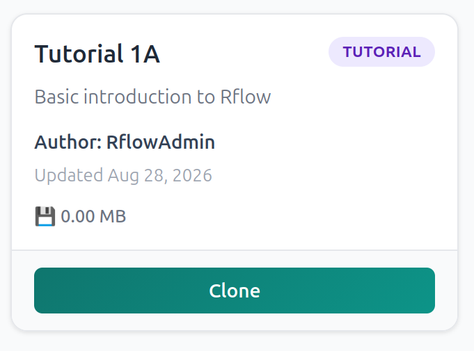{width=25% fig-align="center"}

After clicking the "Clone" button, click on the "My Projects" button to display your own Rflow projects. You should see the tutorial listed as "Tutorial 1A (Copy)". You can click its Edit button if you want to change its name or description. When ready, click on the "Open" button and you should see the pre-prepared workflow:

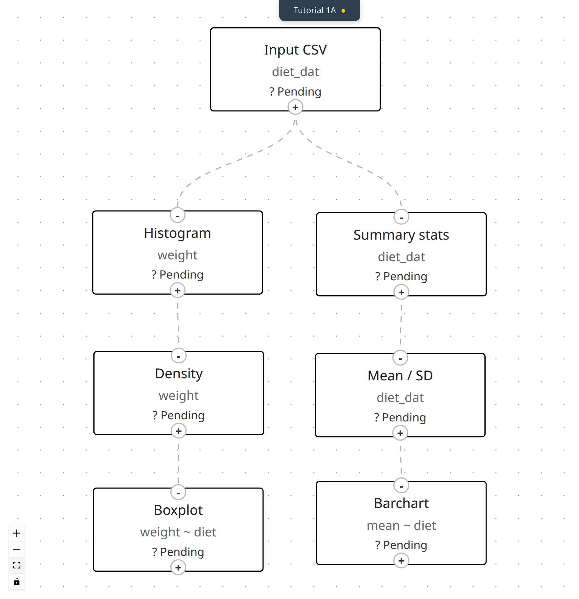{width=50% fig-align="center"}

**Explanation**: Have a quick look at the workflow before we start running it. Reading from top to bottom, then left to right:

* Input CSV: imports your diet_data.csv into R

* Histogram: Frequency histogram of all the chick weights
* Density plot: Density plot of all the chick weights
* Boxplot: Boxplot of chick weights for each diet group
* Summary statistics: simple summary of the contents of your 4 
columns
* Mean / SD: calculates means, standard deviations, standard errors etc. for each diet group
* Barchart: bar chart of mean chick weights with error bars for each diet group

So the left side of the workflow broadly describes the "shape" of the data overall, while the right side gives you information about differences in chick weights with diet, both numerically and visually.

## Step 2: Import the chick_diet.csv dataset
Begin by clicking on the "Input CSV" node and in the Panel on the right, Input panel, upload the `chick_diet.csv` dataset that you downloaded earlier. You'll need to give the R dataframe a name, and if you have cloned the Rflow workflow, downstream nodes will expect you to use `diet_dat` as the dataframe name. Add a comment, which is always good practice, to describe what the node does. Click on the **Run** button to display the Output panel, and view the first 20 rows imported into R dataframe `diet_dat`. Finally, click on the **R code** tab to view the automatically generated R code for this node.

::: {layout-ncol=3}
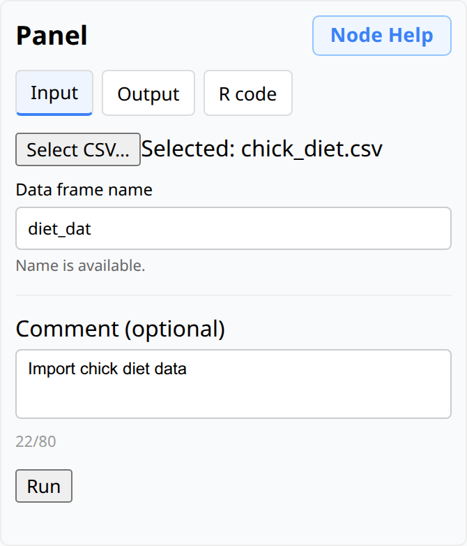

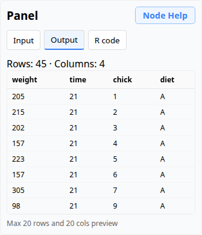

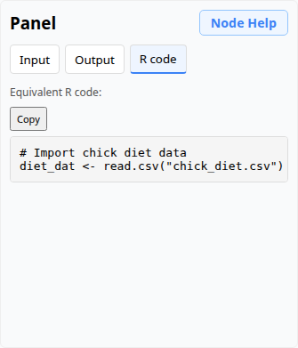
:::

There is the option to copy this code to the clipboard if you want to paste it directly into an R script in RStudio, Positron, VS Code or similar IDE, but we will skip this step for now. Notice also that the Input CSV node now has a green border and has changed from "Pending" to "Completed" to indicate that it has been run successfully.

## Step 3: Data visualisation
The left side branch of this workflow allows you to visualise the shape of the chicks weights, stored in the `weight` column of the `diet_dat` dataframe. We use two popular visualisations: a frequency histogram and probability density plot. Finally, we use a boxplot to compare weights with different diets.

### Step 3a: Frequency histogram

Click on the "Histogram" node and study the Input tab of the Panel on the right. A few things to note:

* If you have cloned the workflow, all of the settings will already be completed
* The node will have detected that `diet_dat` is the input dataframe
* There is a drop-down menu to select the **continuouse** variable for which we want a frequency histogram, in this case `weight`.
* There are a number of options available
- **Fill variable** should you want multiple histograms in one plot, coloured by a categorical variable.
- **Number of bins** This is the number of devisions on the x-axis, and you can accept the default of modify it (as done here).
- **X** and **Y** axis labels. It is good practice to label your axes explicitly rather than accept the defaults.

After running the node, you will see a preview of the frequency histogram in the Output tab of the Panel on the right. Click on the **Zoom** button for a full-size image, and you can also download it as PNG format for import into Microsoft Word, PowerPoint etc. Finally, click on the **R code** tab to view the automatically generated R code for this node:

::: {layout-ncol=3}
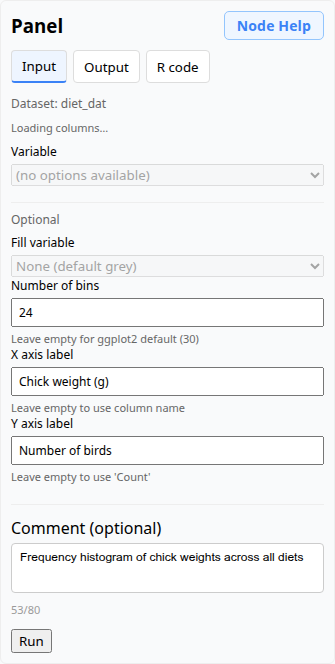

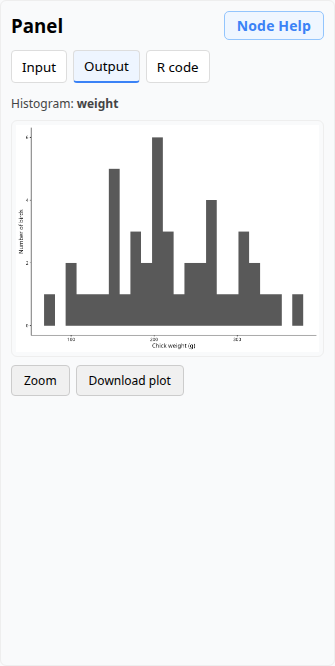

:::

### Step 3b: Density plot

Histograms can sometimes look a bit "blocky" with small datasets, such as this one. A probability density plot is a smoothed version of a histogram, and can be useful for visualising the shape of the data. Click on the "Density plot" node. In the figures below we display the input panel, the output panel and the R code panel. You should see that the input settings are very similar to those for the histogram, except that there is no option for number of bins.

::: {layout-ncol=3}
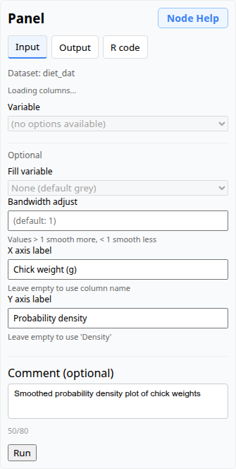

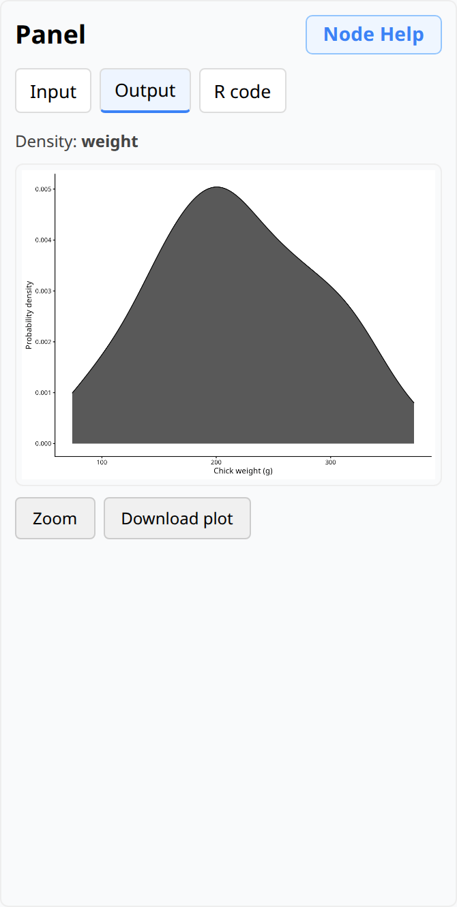

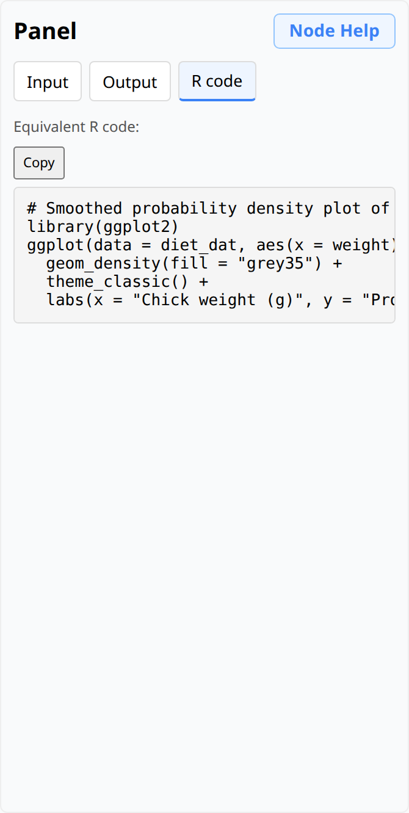
:::

By default in ggplot2 the area under the density curve is equal to 1, and the y-axis is labelled "Density". Also, usually the density plot is just a line, but here we have filled the area using the same grey shading as in the histogram for consistency.

One advantage of density plots, especially for small datasets, is that it is easier to compare distributions for different groups. On the density plot input panel, select `diet` as the **Fill variable** and click **Run**. You should see the following.

::: {layout-ncol=3}
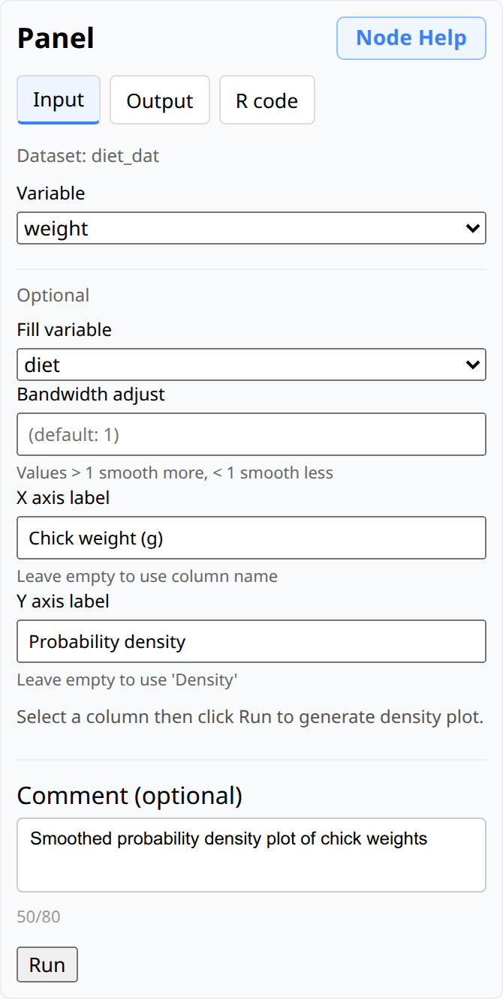

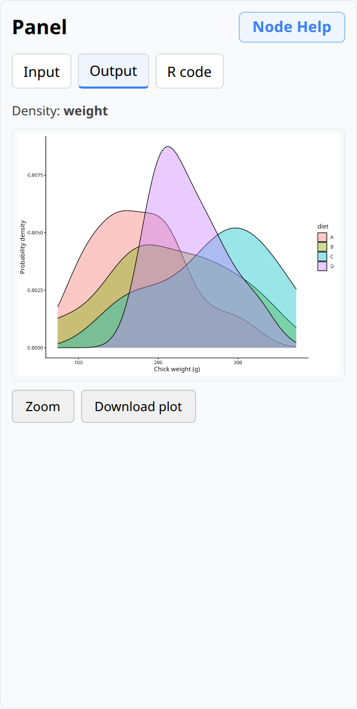

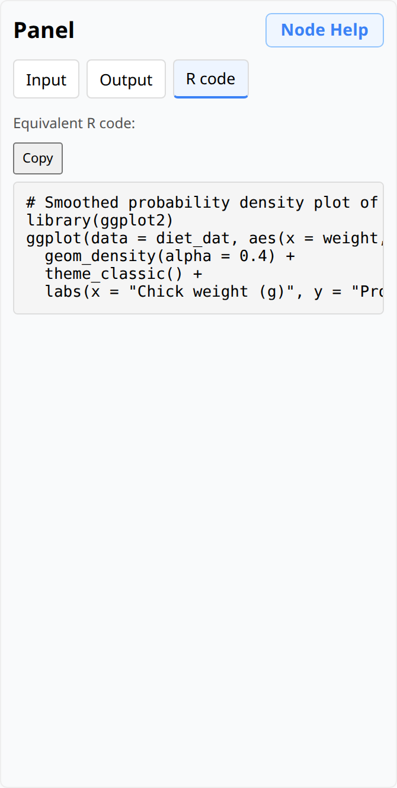
:::

Note that it is now easy to identify that chick weights are generally lower in diet A, generally higher in diet C, and show a larger peak in diet D, and greater spread in diet B. The density plot is a useful visualisation for comparing distributions of continuous variables between groups.

### Step 3c: Boxplot

Boxplots are another useful visualisation to compare distributions of continuous variables between groups. Click on the "Boxplot" node. In the figures below we display the input panel, the output panel and the R code panel. You should see that the input settings are very similar to those for the histogram and density plot.

::: {layout-ncol=3}
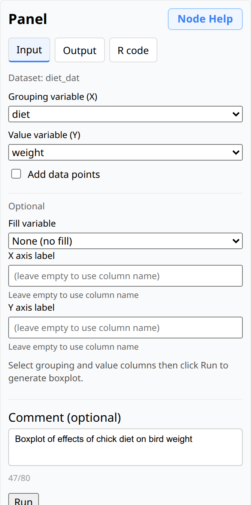

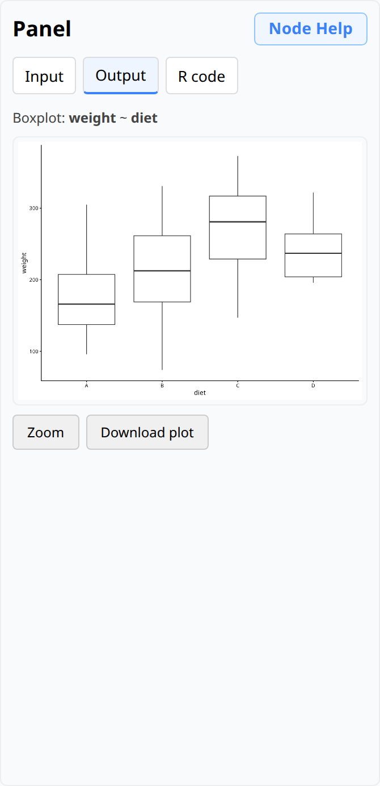

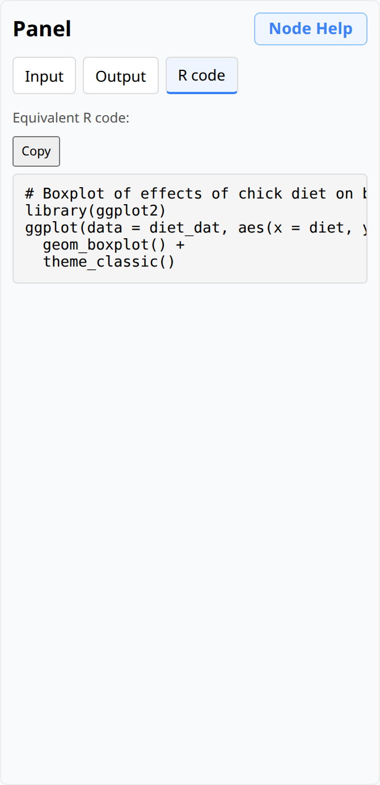
:::

When interpreting boxplots, the box represents the interquartile range (IQR), which contains the middle 50% of the data. The line inside the box is the median, and the "whiskers" extend to the minimum and maximum values within 1.5 times the IQR from the lower and upper quartiles, respectively. Any points outside this range are considered outliers and are plotted individually (there are no outliers in this dataset). Again, you can observe that chick weights are generally lower in diet A, generally higher in diet C, and show a larger peak in diet D, and greater spread in diet B. The boxplot is a useful visualisation for comparing distributions of continuous variables between groups.

## Step 4: Summary statistics
### Step 4a: Summary statistics for the whole dataset

Click on the "Summary" node. In the figures below we display the input panel, the output panel and the R code panel. The Summary node provides a quick overview of the data in each column of your dataframe, including the data type, missing values, and basic summary statistics for each variable.

::: {layout-ncol=3}
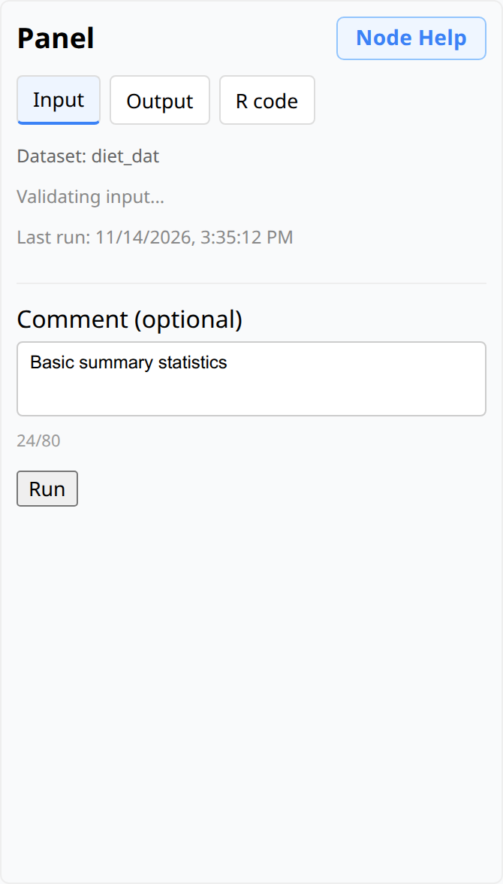

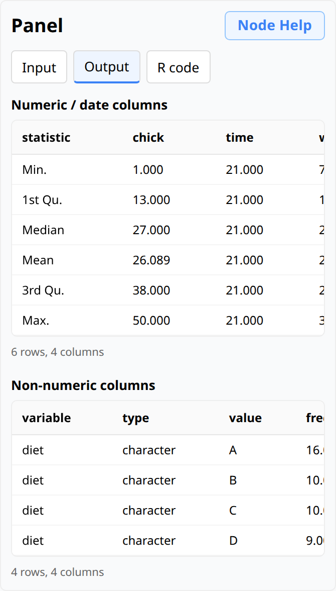

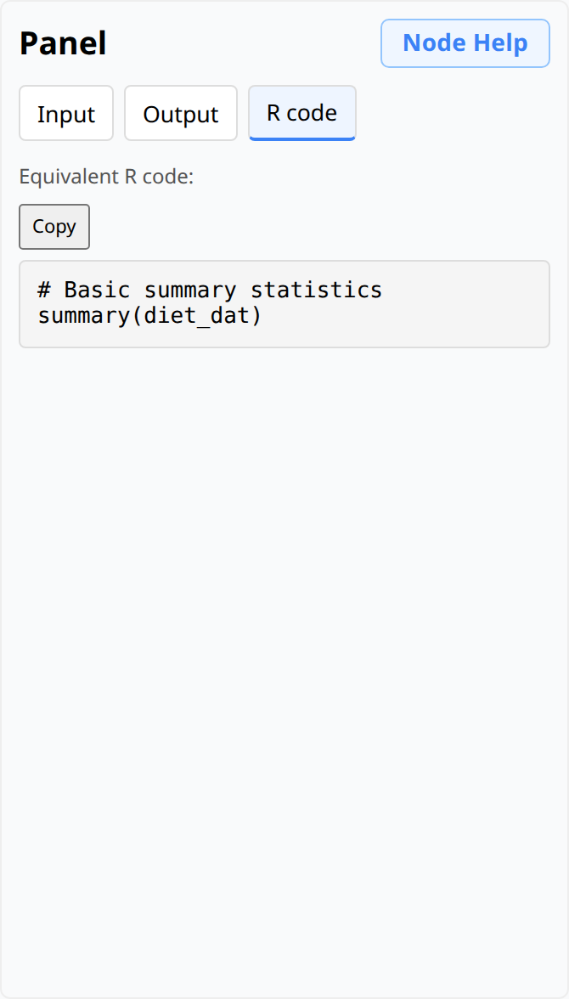
:::

The Summary node is useful for getting a quick overview of your data structure and identifying any potential issues such as unexpected data types or missing values. In this dataset, we have 50 observations with no missing values. The columns are as expected: `weight` (numeric), `time` (numeric, all 21), `chick` (integer, 1-50), and `diet` (factor with 4 levels: A, B, C, D).

### Step 4b: Means, SD and SE for each diet group

Click on the "Means / SD" node. This node also calculates the variance, number of observations, and standard error (SE) for each group. In the figures below we display the input panel, the output panel and the R code panel. This is useful for comparing means and variation across different diet groups.

::: {layout-ncol=3}
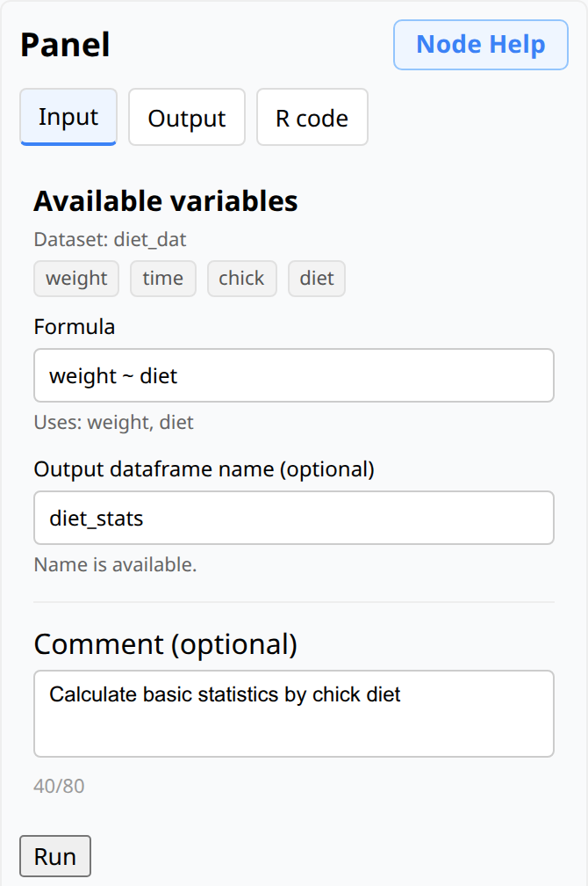

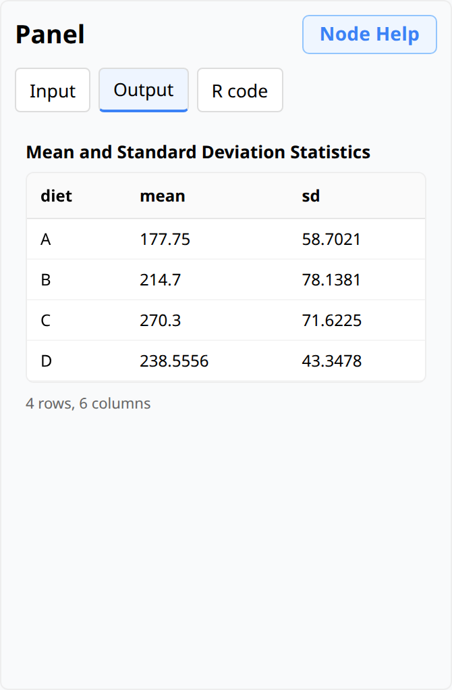

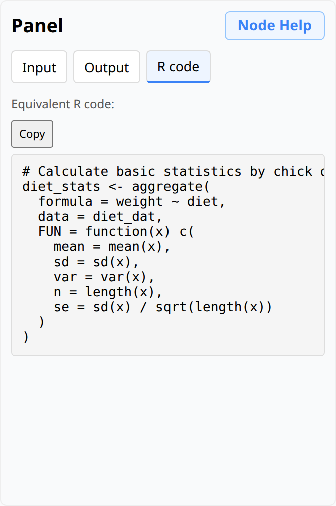
:::

Scroll across in the Output panel to view all the summary statistics. This provides a compact numerical summary of how diet affects chick weight at day 21. You might be surprised at the complexity of the generated R code. This is because R does not have a built-in function to calculate SE, so we write a temporary R `function` to calculate the SE from our data and display the results in tabular format.

### Step 4c: Barchart of means with error bars for each diet group

Click on the "Barchart" node. In the figures below we display the input panel, the output panel and the R code panel. This node creates a bar chart of mean values for each group with error bars representing the standard error, providing a visual representation of the group means and their uncertainty.

::: {layout-ncol=3}
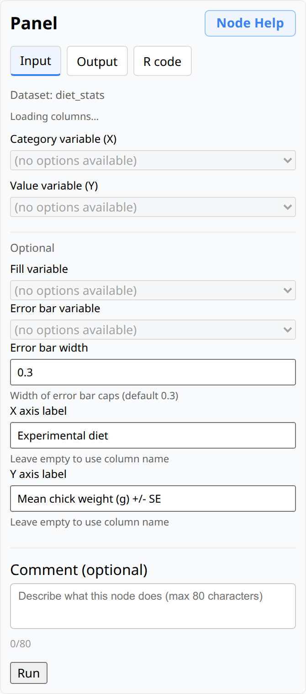

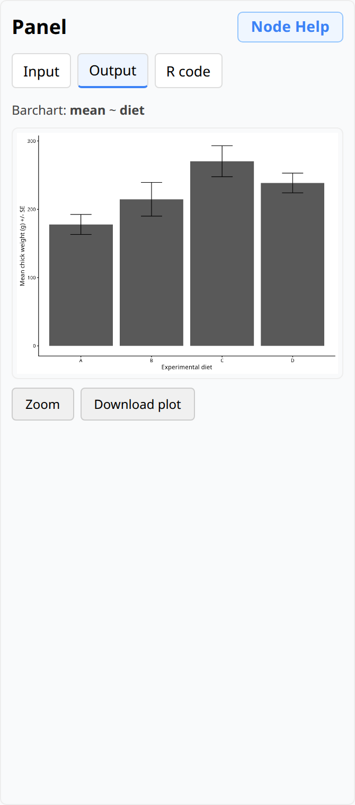

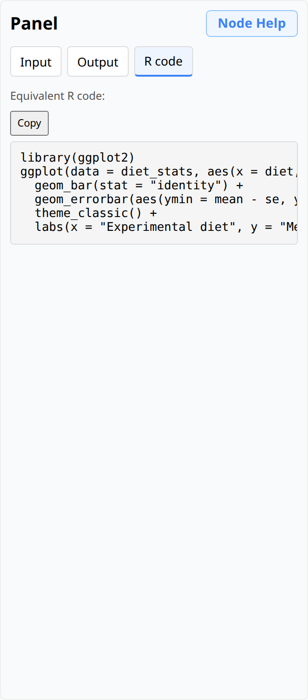
:::

The bar chart visually displays the mean chick weights for each diet group with error bars showing the standard error. **Note**: Bar charts are contentious in data science as they provide less information than boxplots. For example, if your data is skewed around the mean (not normally distributed) this is easy to spot in boxplots, but not in bar charts. However, bar charts are often used in publications and presentations, so it is useful to know how to create them.

## Step 5: Save your workflow and export an R script

The Rflow workflow is autosaved every 30 seconds along with the R objects `diet_dat` and `diet_stats`, and you can manually save the workflow at any time. If you want to use the workflow externally from Rflow, click on the **Download R** button. On most computers this will be downloaded to your "Downloads" folder.

::: {.panel-tabset}

### VS Code

1. Copy the downloaded R script to your working folder (directory). Also ensure that the `chick_diet.csv` file is in the same working folder.
2. Open VS Code and click on the Extensions button on the left sidebar. Search for "R Extension for Visual Studio Code" and install the R extension.
3. Open the R script in VS Code. You should see the R code that was generated by Rflow.
4. The R script uses the `ggplot2` package for plotting. You may need to install this into R if you have not already done so, via `install.packages("ggplot2")`.
5. You can run the entire script by clicking on the "Run" button at the top of the VS Code window, or you can run individual lines or sections of code by highlighting them and pressing `Ctrl + Enter` (or `Cmd + Enter` on Mac). The output will be displayed in the R terminal within VS Code.

### Positron

1. Copy the downloaded R script to your working folder (directory). Also ensure that the `chick_diet.csv` file is in the same working folder.
2. Open Positron and click on the "File" menu, then select "Open File" and navigate to your working folder to open the R script.
3. The R script uses the `ggplot2` package for plotting. You may need to install this into R if you have not already done so, via `install.packages("ggplot2")`. Recent versions of Positron should detect if this needs installing and prompt you to do so.
4. You can run the entire script by clicking on the "Source" button at the top of the Positron window, or you can run individual lines or sections of code by highlighting them and pressing `Ctrl + Enter` (or `Cmd + Enter` on Mac). The output will be displayed in the R console within Positron.

### RStudio

1. Copy the downloaded R script to your working folder (directory). Also ensure that the `chick_diet.csv` file is in the same working folder.
2. Open RStudio and click on the "File" menu, then select "Open File" and navigate to your working folder to open the R script.
3. The R script uses the `ggplot2` package for plotting. Recent versions of RStudio should detect if this needs installing and prompt you to do so. If not, you can install it manually via `install.packages("ggplot2")`.
4. RStudio needs to know in which folder it is operating. You can set the working directory by clicking on "Session" > "Set Working Directory" > "Choose Directory..." and selecting your working folder. Another option is to create an RStudio project in your working folder, which will automatically set the working directory to that folder. If you obtain a `File not found` when trying to import the `chick_diet.csv` file, this is likely the cause. You can check the current working directory by running `getwd()` in the R console.
5. Run the entire script by clicking on the "Source" button at the top of the RStudio window, or you can run individual lines or sections of code by highlighting them and pressing `Ctrl + Enter` (or `Cmd + Enter` on Mac). The output will be displayed in the R console within RStudio.

:::