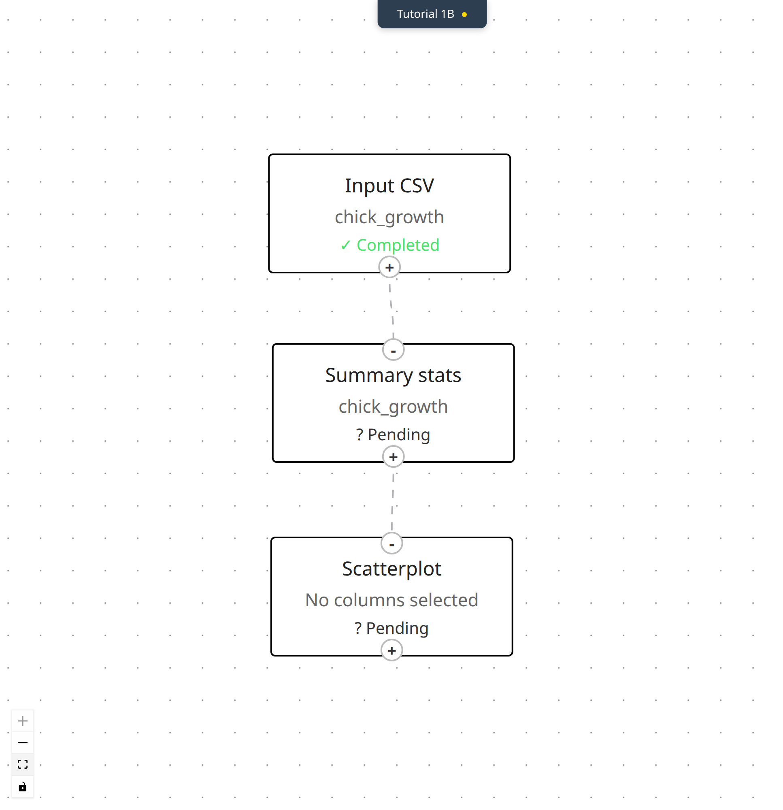
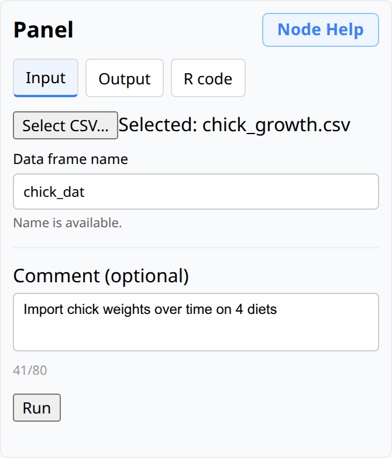
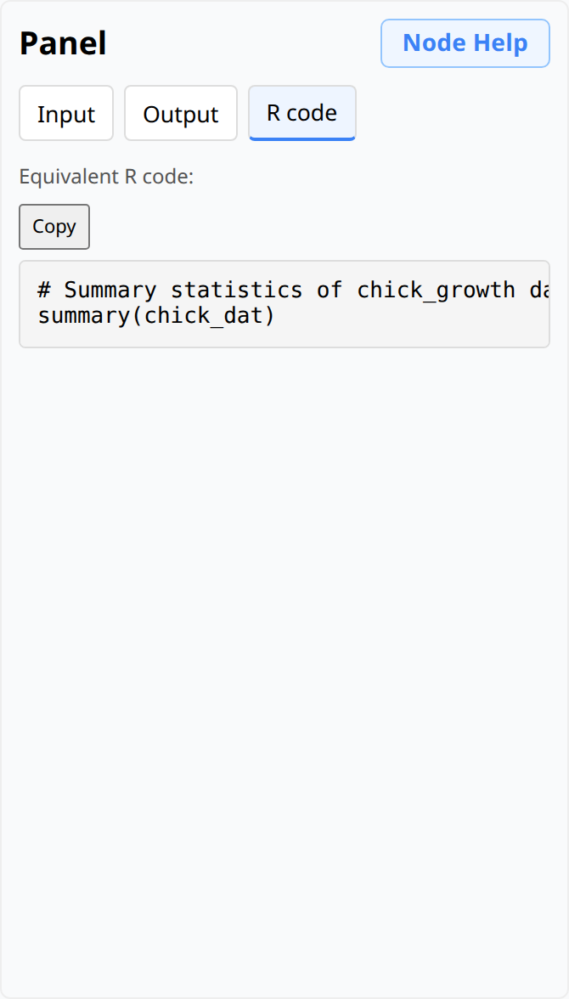

# Learning Objectives

This is a very simple tutorial to illustrate how to display continuous data. The data is similar to that used in Tutorial 1A, but now you have information about the weight of the chicks on different days. Thus you can visualise how the weight of the chicks changes over time. Begin by downloading the data file [chick_growth.csv](data_workflows/chick_growth.csv){download=""} The dataset has 3 columns:

* `weight` - the weight of the chick in grams
* `time` - the time in days since the chick hatched
* `diet` - the diet that the chick was fed (A to 

# Step 1: Clone the Rflow project
Hit the "Clone" button in the top right corner of this page to create a copy of this Rflow tutorial 1b in your own account. You can then edit the project and run the code. Once it is cloned, go back to your Rflow projects and open the tutorial:

{width=50% fig-align="center"}

You can see that the project is very simple with just three nodes:

* Input CSV - imports the data from the CSV file
* Summary - calculates summary statistics for the data
* Scatterplot - creates a scatterplot of the data

# Step 2: Import the data
The first node is an Input CSV node. Click on the node to open it and then click the "Choose file" button to select the `chick_growth.csv` file that you downloaded earlier. Once you have selected the file, click "Run" to import the data. The Input, Output and R Code panels are shown below:

::: {layout-ncol=3}

:::

You can see that the data has been imported successfully and is displayed in the Output panel. The R code used to import the data is shown in the R Code panel. You can also see that the data has 3 columns and 60 rows.

# Step 3: Calculate summary statistics
The next node is a Summary node. Click on the node to open it and then click "Run" to calculate summary statistics for the data. The Input, Output and R Code panels are shown below:

::: {layout-ncol=3}

:::

Note that you have a mixture of continuous and categorical data; the `weight` is your response variable (continuous) whilst `time` and `diet` are your explanatory variables (continuous and categorical respectively).

# Step 4: Create a scatterplot
The final node is a Scatterplot node. Click on the node to open it and then click "Run" to create a scatterplot of the data. The Input, Output and R Code panels are shown below:

::: {layout-ncol=3}

:::
