# Learning Objectives

This is a very simple tutorial to illustrate how to display continuous data. The data is similar to that used in Tutorial 1A, but now you have information about the weight of the chicks on different days. Thus you can visualise how the weight of the chicks changes over time. Begin by downloading the data file [chick_growth.csv](data_workflows/chick_growth.csv){download=""} The dataset has 3 columns:

* `weight` - the weight of the chick in grams
* `time` - the time in days since the chick hatched
* `diet` - the diet that the chick was fed (A to 

# Step 1: Clone the Rflow project
Hit the "Clone" button in the top right corner of this page to create a copy of this Rflow tutorial 1b in your own account. You can then edit the project and run the code. Once it is cloned, go back to your Rflow projects and open the tutorial:

{width=50% fig-align="center"}

You can see that the project is very simple with just three nodes:

* Input CSV - imports the data from the CSV file
* Summary - calculates summary statistics for the data
* Scatterplot - creates a scatterplot of the data

# Step 2: Import the data
The first node is an Input CSV node. Click on the node to open it and then click the "Choose file" button to select the `chick_growth.csv` file that you downloaded earlier. Once you have selected the file, click "Run" to import the data. The Input, Output and R Code panels are shown below:

::: {layout-ncol=3}

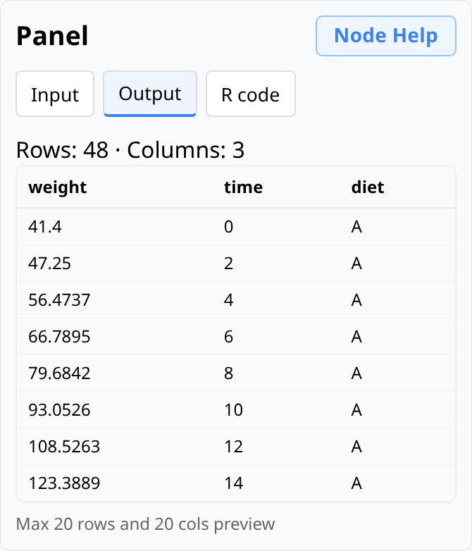

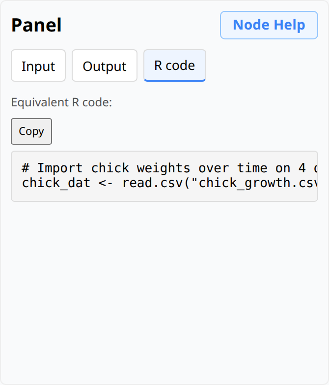
:::

You can see that the data has been imported successfully and is displayed in the Output panel. The R code used to import the data is shown in the R Code panel. You can also see that the data has 3 columns and 60 rows.

# Step 3: Calculate summary statistics
The next node is a Summary node. Click on the node to open it and then click "Run" to calculate summary statistics for the data. The Input, Output and R Code panels are shown below:

::: {layout-ncol=3}
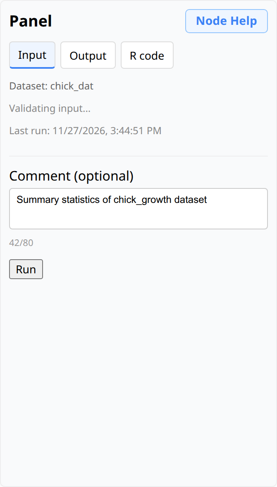

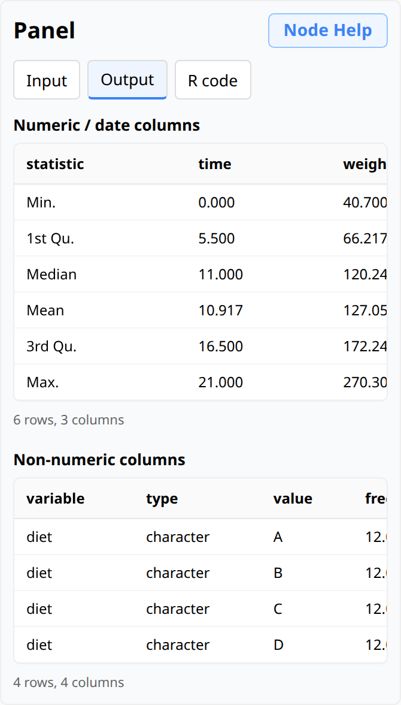

:::

Note that you have a mixture of continuous and categorical data; the `weight` is your response variable (continuous) whilst `time` and `diet` are your explanatory variables (continuous and categorical respectively).

# Step 4: Create a scatterplot
The final node is a Scatterplot node. Click on the node to open it and then click "Run" to create a scatterplot of the data. The Input, Output and R Code panels are shown below:

::: {layout-ncol=3}
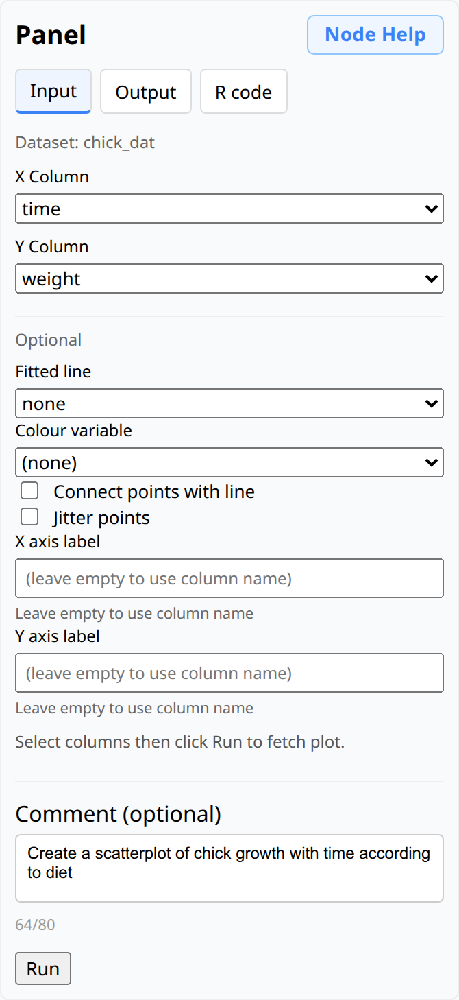

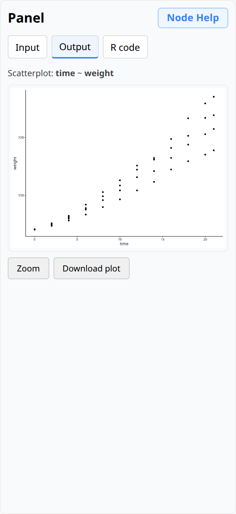

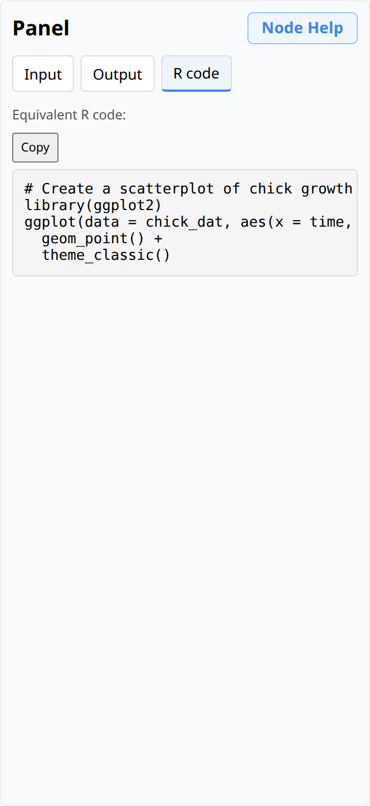
:::

Obviously, whilst this scatterplot shows the relationship between weight and time, it is not very informative as it ignores the chick diet. You can improve the scatterplot by adding a colour label. Modify the Scatterplot node by clicking on the "Colour variable" dropdown and selecting `diet`. In the "X axis label" box enter "Time". In the "Y axis label" box enter "Chick Weight (g)". Then click "Run" to update the scatterplot. The updated scatterplot is shown below:

::: {layout-ncol=3}
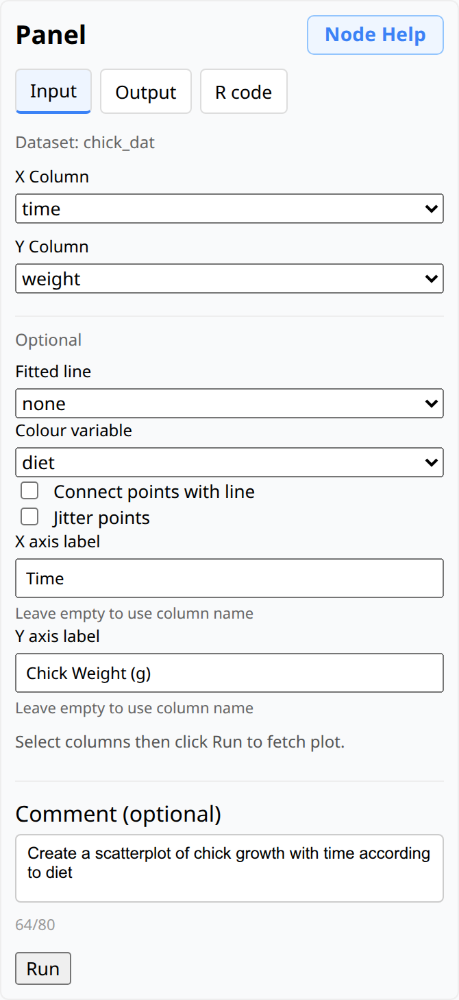

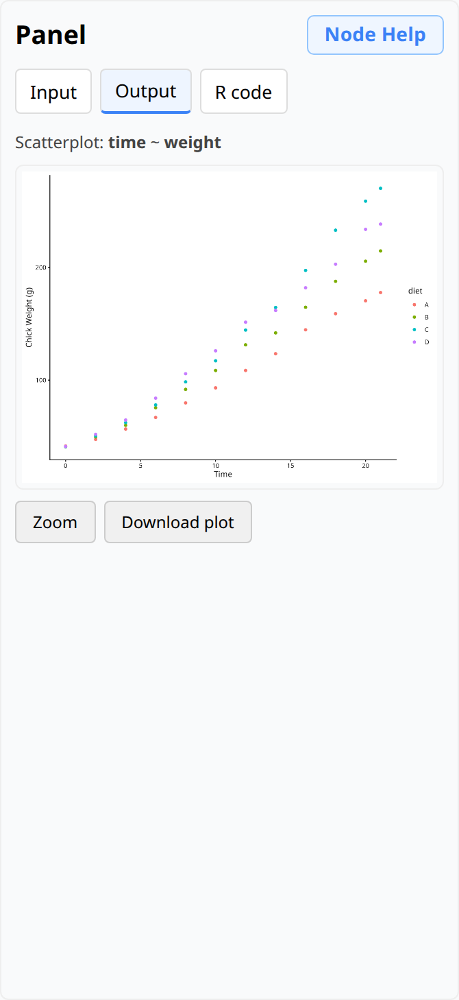

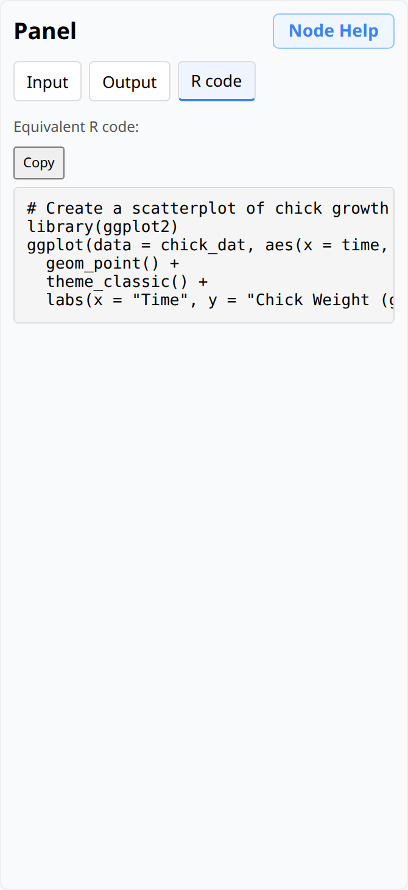
:::

Finally, we know the chick weights are increasing over time, so it is sensible to add lines to the scatterplot to indicate this. As we are not fitting a statistical model to the data, we will simply use straight lines to connect each point to the next point. Click the "Connect points with lines" checkbox and then click "Run" to update the scatterplot. The final scatterplot is shown below:

::: {layout-ncol=3}
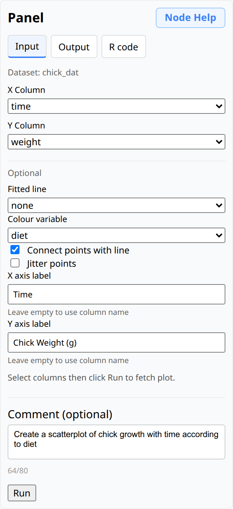
    
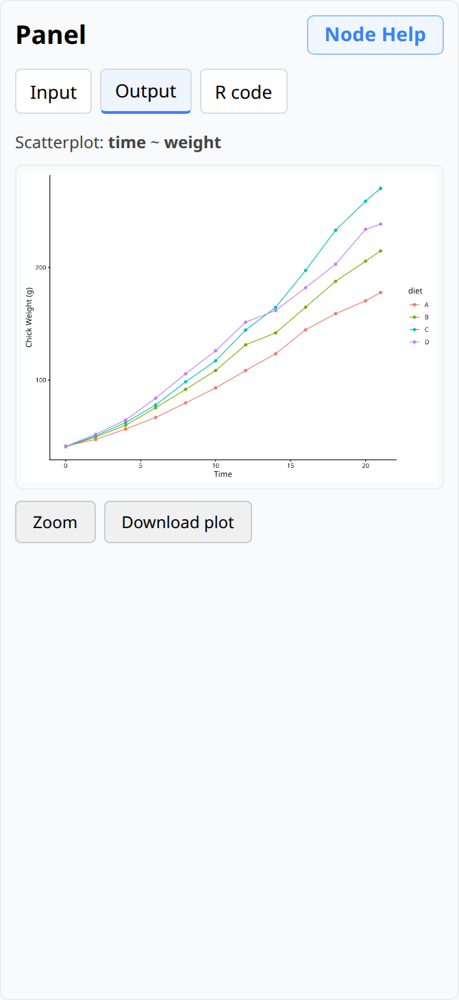

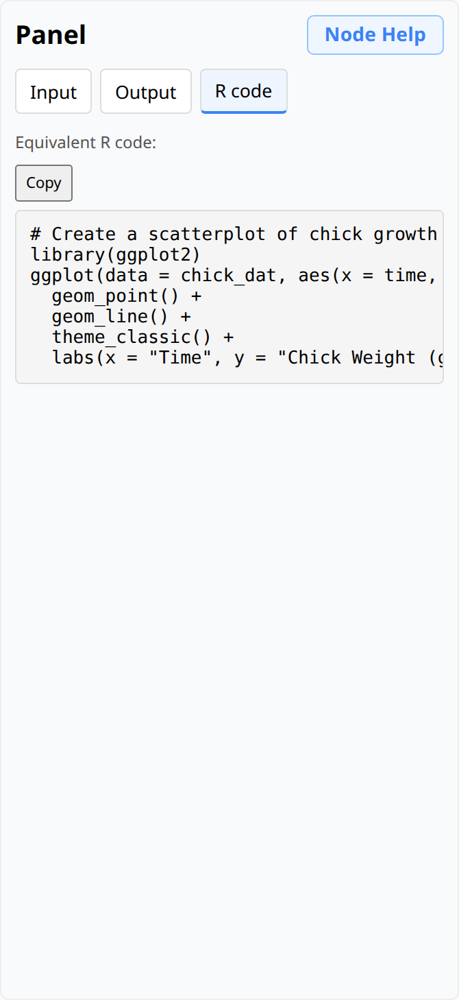
:::

Whilst it is tempting to connect the points with fitted straight lines or curves, we generally recommend that you do not do this until you have fitted a statistical model to the data. This is because the fitted lines or curves may not be appropriate for the data and can be misleading.

# Step 5: Save your workflow and export an R script

The Rflow workflow is autosaved every 30 seconds along with the R object `chick_dat`, and you can manually save the workflow at any time. If you want to use the workflow externally from Rflow, click on the **Download R** button. On most computers this will be downloaded to your "Downloads" folder. The following instructions are almost identical to those in Tutorial 1A, but are repeated here for completeness. You can run the R script in VS Code, Positron or RStudio.

::: {.panel-tabset}

### VS Code

1. Copy the downloaded R script to your working folder (directory). Also ensure that the `chick_growth.csv` file is in the same working folder.
2. Open VS Code and click on the Extensions button on the left sidebar. Search for "R Extension for Visual Studio Code" and install the R extension.
3. Open the R script in VS Code. You should see the R code that was generated by Rflow.
4. The R script uses the `ggplot2` package for plotting. You may need to install this into R if you have not already done so, via `install.packages("ggplot2")`.
5. You can run the entire script by clicking on the "Run" button at the top of the VS Code window, or you can run individual lines or sections of code by highlighting them and pressing `Ctrl + Enter` (or `Cmd + Enter` on Mac). The output will be displayed in the R terminal within VS Code.

### Positron

1. Copy the downloaded R script to your working folder (directory). Also ensure that the `chick_growth.csv` file is in the same working folder.
2. Open Positron and click on the "File" menu, then select "Open File" and navigate to your working folder to open the R script.
3. The R script uses the `ggplot2` package for plotting. You may need to install this into R if you have not already done so, via `install.packages("ggplot2")`. Recent versions of Positron should detect if this needs installing and prompt you to do so.
4. You can run the entire script by clicking on the "Source" button at the top of the Positron window, or you can run individual lines or sections of code by highlighting them and pressing `Ctrl + Enter` (or `Cmd + Enter` on Mac). The output will be displayed in the R console within Positron.

### RStudio

1. Copy the downloaded R script to your working folder (directory). Also ensure that the `chick_growth.csv` file is in the same working folder.
2. Open RStudio and click on the "File" menu, then select "Open File" and navigate to your working folder to open the R script.
3. The R script uses the `ggplot2` package for plotting. Recent versions of RStudio should detect if this needs installing and prompt you to do so. If not, you can install it manually via `install.packages("ggplot2")`.
4. RStudio needs to know in which folder it is operating. You can set the working directory by clicking on "Session" > "Set Working Directory" > "Choose Directory..." and selecting your working folder. Another option is to create an RStudio project in your working folder, which will automatically set the working directory to that folder. If you obtain a `File not found` when trying to import the `chick_growth.csv` file, this is likely the cause. You can check the current working directory by running `getwd()` in the R console.
5. Run the entire script by clicking on the "Source" button at the top of the RStudio window, or you can run individual lines or sections of code by highlighting them and pressing `Ctrl + Enter` (or `Cmd + Enter` on Mac). The output will be displayed in the R console within RStudio.

:::
